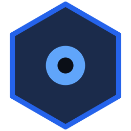

<p align="center">
  
</p>

<h1 align="center">NeuroWatch</h1>

<p align="center">
  <b>Turn the computer you already have into a security camera recorder.</b><br>
  Watch every camera live, record around the clock to your own drive, and find any moment in seconds.<br>
  Free for up to 16 cameras; NeuroWatch Unlimited is USD 50 once. Open source. No account needed for local use.
</p>

<p align="center">
  <a href="https://neurowatch.app/downloads?version=latest&platform=windows&arch=x86_64&kind=installer"></a>
  &nbsp;
  <a href="https://neurowatch.app/downloads?version=latest&platform=linux&arch=x86_64&kind=deb"></a>
</p>

<p align="center">
  Also for
  <a href="https://neurowatch.app/downloads?version=latest&platform=linux&arch=x86_64&kind=rpm">Fedora (.rpm)</a> ·
  <a href="https://neurowatch.app/downloads?version=latest&platform=linux&arch=x86_64&kind=arch">Arch Linux</a> ·
  <a href="https://neurowatch.app/downloads?version=latest&platform=linux&arch=arm64&kind=deb">Linux ARM (.deb)</a> ·
  <a href="https://neurowatch.app/downloads?version=latest&platform=linux&arch=arm64&kind=rpm">Fedora ARM</a> ·
  portable <a href="https://neurowatch.app/downloads?version=latest&platform=windows&arch=x86_64&kind=portable">Windows .zip</a>,
  <a href="https://neurowatch.app/downloads?version=latest&platform=linux&arch=x86_64&kind=portable">Linux .tar.gz</a>,
  <a href="https://neurowatch.app/downloads?version=latest&platform=linux&arch=arm64&kind=portable">ARM .tar.gz</a><br>
  <a href="https://neurowatch.app">Website: neurowatch.app</a> ·
  <a href="https://github.com/ttheekw/Neurowatch/releases/latest">Release notes and checksums</a> ·
  <a href="#installing">Installation help</a> ·
  <a href="docs/system-requirements.md">System requirements</a>
</p>

<p align="center">
  <a href="https://github.com/ttheekw/Neurowatch/releases/latest"></a>
  <a href="https://github.com/ttheekw/Neurowatch/actions/workflows/ci.yml?query=branch%3Amain"></a>
  <a href="#installing"></a>
  <a href="LICENSE"></a>
  <a href="https://neurowatch.app"></a>
</p>

### Why NeuroWatch

- **Record to your own drive.** Cloud access and external alert notifications are optional; local recording works without a cloud account.
- **Free for up to 16 cameras.** NeuroWatch Unlimited removes the software camera limit; capacity depends on your computer. Both editions are open source and can be used at home or in a business.
- **Connect your existing cameras.** Add RTSP streams or use **Search Network** to discover ONVIF cameras. Compatibility depends on the camera's streams and ONVIF support.
- **Keep recording in the background.** Recording carries on after you close the window, can start automatically, and reconnects cameras when they drop.
- **Watch from anywhere, if you want to.** Optional NeuroWatch Cloud access shows your cameras in a browser. Cloud plans are separate from the desktop editions.

> **Beta:** the release workflow checks installation and generated video on Windows, Ubuntu 22.04 and 24.04, Debian 12 and 13, Fedora 43 and Arch Linux before publishing. These checks do not qualify physical cameras, GPUs or displays. Found a problem? [Tell us](https://github.com/ttheekw/Neurowatch/issues), it makes the next release better.

NeuroWatch is **free and open source** ([Apache-2.0](LICENSE)), including its NeuroWatch Cloud client. The optional NeuroWatch Cloud, for watching from a browser, is an online service (see [Licensing](#licensing)).

## Contents

- [Features](#features)
- [Installing](#installing)
- [Getting started](#getting-started)
- [Everyday use](#everyday-use)
- [Running without a screen](#running-without-a-screen)
- [Running in Docker](#running-in-docker)
- [Troubleshooting](#troubleshooting)
- [Privacy and responsible use](#privacy-and-responsible-use)
- [Disclaimer](#disclaimer)
- [Licensing](#licensing)
- [For developers](#for-developers)

---

## Features

### Live video wall
- Watch all your cameras on one screen, in a ready-made or custom grid (2×2, 3×3, 4×4, and so on).
- More cameras than fit? They continue on further pages. Flip through them with the arrows or keyboard, or let the wall **auto-scroll**. NeuroWatch keeps previews ready between page changes.
- **Arrange the wall with the mouse:** drag a camera onto another to swap them, drag it to an empty slot to move it, or drag its corner to make it larger (2×2, 3×2, …). Hold a camera at the edge of the wall to carry it to another page.
- **Double-click** any camera to watch it alone, full size. Hold **Ctrl** and scroll to zoom into a picture.
- **Full screen** with one key, and **Hide panels** to leave nothing but the video. The status readings can stay on screen over the video, with an adjustable see-through background.
- **More windows and monitors:** move a page of cameras into its own window, put it on another monitor, and give it its own grid and layout. A window can hold several pages and cycle through them. Your windows come back where you left them the next time you start NeuroWatch.
- Uses your graphics card to decode video where possible (Intel/AMD and NVIDIA), and shows smaller grid streams in multi-camera views.

### Cameras
- **Search Network** finds ONVIF cameras on your network, shows their model and whether they're ready, need a password, or are already added. Then add them in a few clicks.
- Or add one by its address on the **Camera** tab, two ways: **Automatic (ONVIF)** asks the camera for its streams (enter its address, username and password, then **Load Streams**, and pick the main and grid stream from the lists), or **Stream URLs** for any camera by its stream address: RTSP/RTSPS, RTMP, MJPEG over HTTP(S), USB cameras, or a video file.
- **Edit Camera** opens on the same tab with the camera's saved streams to choose from. Its password is kept unless you type a new one.
- **Several streams per camera:** NeuroWatch records the best-quality stream and shows a lighter one in the grid. You can pick another stream for any tile from its right-click menu.
- Test a camera before saving it, and see each camera's live status, codec and resolution on its tile.
- **Audio:** cameras that send supported sound (AAC, G.711, Opus or PCM) are recorded with it. Tiles of cameras with audio show a speaker at the top right: click it, or right-click → **Listen**, to hear that camera live. One camera at a time; the sound stops when the camera leaves the screen.
- **PTZ controls:** right-click a live camera → **PTZ Controls…** to pan, tilt and zoom a compatible ONVIF camera. Hold a direction or zoom button to move and release to stop; use Home and camera presets where supported.
- **Two-way audio:** right-click a live camera → **Talk…**, then hold **Hold to Talk** or the Space bar to speak through its speaker. Requires a microphone and a camera with a supported ONVIF G.711 audio backchannel; a test tone is available to check the speaker.
- NeuroWatch won't add the same camera twice, and reconnects by itself when a camera drops out.

### Events

- **Computer motion detection:** enable **NeuroWatch detection** in Edit Camera → Motion to analyze a separate stream, preferably the lower-resolution substream. Set sensitivity, minimum duration, cooldown, and watched/ignored zones using a camera snapshot. Watch the live analysis picture, highlighted changed blocks and score in the Motion tab while checking saved settings. **Low CPU mode (keyframes only)** decodes fewer pictures but can miss short movements; it uses software decoding and is off by default. Main-stream fallback is explained when no grid stream is available. Detection also works without the desktop window, adds decoding work, and does not share the recording pipeline. Diagnostics reports motion decoders, analysis FPS, detector time and queue drops.
- **Camera motion events:** compatible ONVIF cameras can report their own motion detection. Turn on **Camera's own detection** in a camera's **Motion** tab (Edit Camera), and NeuroWatch records each motion event without continuously decoding video for detection. Event pictures use a short, one-frame snapshot. Supported camera analytics also report intrusion, line crossing, tampering and alarm inputs. The Motion tab shows whether the camera is sending its events. Set where and how sensitively the camera looks for motion in the camera's own web settings.
- Cameras send their events straight to NeuroWatch when they can reach your computer (TCP port 7681; allow it in your firewall if one blocks cameras). Otherwise NeuroWatch asks each camera for its events every few seconds, automatically; the Motion tab says which.
- **See events in the app:** the **Events** tab lists activity and alerts as they happen. Search your event history by camera, event or details; filter by camera, event type, ongoing/finished status and date range. Click a column heading to sort the loaded rows, and **Show Older** to go further back. Double-click an event to watch that moment in Playback. The tab counts new events while you're elsewhere; a camera's tile shows an orange **MOTION** badge while the camera sees motion.
- **Motion alerts on tiles:** an orange bell icon at the top right stays after motion ends, including when you change pages or reopen the app. Click the icon to clear the events seen so far; new motion brings it back. Clearing the alert keeps the event history. In **Playback**, orange marks on each camera's timeline show motion, intrusion and line crossing: hover for the event's time and duration, or click there to seek through the recordings.
- **Problems are events too:** a camera going offline (and coming back), a recording that keeps failing, and a recording drive that is almost full are noted with their times, also when NeuroWatch runs without a screen.
- See them from a terminal with `neurowatch events` (the latest 20), `neurowatch events --follow` (and new ones as they happen) or `--camera "Front Door"`. Event history is kept for 30 days by default; kept bookmarks are retained until you release them.

### Alert notifications

- Open **≡ → Alert Notifications…** to add channels for **This computer**, **ntfy push**, **Telegram** or a **Webhook**. External channels can include an event picture and work without linking NeuroWatch Cloud.
- Choose which events and cameras send alerts, set active weekly hours and a cooldown, send a test, and check delivery history.
- Desktop notifications need the desktop app running. ntfy, Telegram and webhook deliveries run in the recorder, including headless mode. Email delivery is not implemented.

### Local accounts and permissions

- Open **≡ → Users & Permissions…** to create local accounts and enable sign-in. Accounts are optional and are off by default; they are separate from your NeuroWatch Cloud account.
- **Viewers** watch live video and recordings and review events. **Operators** can also control PTZ, talk, add bookmarks, export clips and start or stop recording. **Admins** manage cameras, settings, alerts and accounts.
- Limit viewers and operators to selected cameras. Local accounts control access through the app; keep the computer account and configuration files secure too.

### Recording and playback
- Record all cameras or only the ones you choose, around the clock, to your computer's drive.
- **Weekly recording schedules:** right-click a camera tile, choose **Edit Camera → Recording**, then choose Continuous, Event retention or Off, then drag across the weekly grid to paint hours or 15-minute intervals. Use **Edit exact time windows** for minute precision, including overnight. Faint cells use the default; erase restores it and **Undo paint** reverses edits. Schedules follow the recorder’s local clock through daylight-saving changes. Manual Start/Stop overrides the schedule until the recorder restarts. The hosted portal offers the same policy controls.
- **Copy recording policies:** in **Edit Camera → Recording → Copy to cameras…**, select cameras and confirm. This saves the shown modes, schedule, padding and retention settings to those cameras immediately. Each camera keeps its recording enable switch, storage path, quota and motion settings. The source camera still needs **Save**.
- **Event retention** records continuously, then trims footage without events; it saves space, not disk writes. Choose footage before/after events and how long to keep non-event footage. Cleanup waits through a safety grace and pauses if recording or detection is unhealthy; older continuous footage is not enrolled. Quota and drive limits still apply to event footage.
- **Choose Drive…** lists your drives with their free space and records to the one you pick. The new location takes effect immediately.
- **Disk cleanup:** when the recording drive gets fuller than a limit you choose (90% by default), NeuroWatch deletes eligible older recordings to make room. Configure it in **Settings → Recording**; each camera can also have its own **Storage Quota**. Cleanup leaves your other files and footage protected by kept bookmarks alone. It cannot guarantee free space if other files or kept footage fill the drive.
- **Missing-drive protection:** if a recording drive is disconnected or a network share is not mounted, NeuroWatch pauses recording there instead of quietly filling your computer's own disk. The cameras show recording **failed**, a **Recording storage missing** event (and alert, if you set one up) says which folder, and recording carries on by itself once the drive is back. NeuroWatch recognises its folders by a small `.neurowatch-storage` file; please leave it there. A missing marker also blocks recording even if the folder exists.
- **Archive to a NAS:** **Settings → Archive** moves recordings older than a few days (7 by default) to another folder, such as a network share, and Playback and Export still find them there. Each recording is checked against the original before it is removed from the recording drive. You can limit the archive's size, the hours it runs (for example only at night) and its speed. This lets you keep new recordings on the computer while moving older footage to the NAS.
- **Playback:** a timeline with several cameras side by side, with play/pause, seek and speed controls. Turn on **Events only** to skip quiet time and pause at the last recorded event; turn it off for normal review. The **Events** sidebar offers searchable lists or paged **Thumbnails** of saved images, with zone names, peak score and changed-area details when available.
- **Review events while playing recordings:** open **Events** on the desktop timeline or **Review events** in the portal. Filter the loaded range by event type, acknowledgement or text (and camera on desktop), see a saved event picture, and review its recording with a short lead-in. Coloured timeline marks distinguish motion, bookmarks and camera alerts; hover shows the type and full time.
- **Bookmarks:** right-click a live camera → **Add Bookmark…**, or use **Add Bookmark** in Playback, to mark a moment or time span with a note. **Keep this footage** protects the matching recordings, with 30 seconds of padding on each side, from quota, disk and event-retention cleanup until you unmark it. Kept footage still uses disk space.
- **Export an event:** choose **Export event…** on desktop to prepare a clip with that camera's pre/post padding. In portal recording review, select an event and choose **Prepare event clip** with the padding you want (where export is available). Review the yellow handles, then export; missing footage and clip limits are explained.
- **Export Video:** **File → Export Video…** saves a clip as an MP4 file you can share. Load a camera's recordings, drag the yellow handles on the timeline to the part you want (a preview plays it), press **Export…** and choose where to save. The video is copied as recorded, so it is quick and keeps the camera's quality. A clip may start a moment before the time you chose, and gaps where nothing was recorded are left out.
- **Export from the web portal:** a camera's **Export** tab in NeuroWatch Cloud lets you play its recordings and drag the start and end of a clip on the timeline; the recorder makes the MP4 and uploads it for download through the portal.
- **Playback with sound:** recordings with audio play it back. The first camera with audio is heard; click another tile's speaker to switch, or the same one to mute. Sound keeps its normal pitch from 0.5× to 2× speed and is muted at faster or slower speeds.
- **Sound in the web portal:** live view and recordings watched in the portal carry the camera's sound too. It starts muted; click **Sound off** above the video to hear it. Recordings play their sound at 1× speed.

### Always recording, in the background
- NeuroWatch keeps recording after you close the window. By default it starts by itself when you log in. Configure **Settings → Startup** to change this or, on Linux, enable recording from boot before sign-in.
- A **tray icon** shows NeuroWatch's state at a glance. Hover over it for a short summary, or open its menu to open NeuroWatch or start, stop or restart recording.
  - The **bottom dot** is green when everything is fine, amber when something needs attention, red when NeuroWatch is stopped or every camera is offline, and grey while starting or stopping.
  - A small **red dot at the top** appears when there's a problem: cameras offline, a recording that failed, the cloud unreachable, or the computer struggling (CPU, memory or graphics). The menu names each problem.
- **Headless mode** for a computer without a screen: NeuroWatch can run without the desktop window. On Linux with a systemd user service and boot startup enabled, recording starts even if nobody logs in. See [Running without a screen](#running-without-a-screen).

### NeuroWatch Cloud (optional)
NeuroWatch Cloud is an optional online service for browser access. Its plans are separate from the Free and Unlimited desktop editions; see [neurowatch.app](https://neurowatch.app) for current plans. Cloud support is built into both editions and source builds.
- Link NeuroWatch to your NeuroWatch Cloud account with a one-time code (**Settings → Cloud**, or click **Cloud** in the status bar).
- Then watch live video and recordings from a web browser, with camera thumbnails.
- Manage it from the web portal, with or without a screen: add and edit cameras, turn recording on or off, and choose the recording drive. The desktop app shows changes made there at once. You can also see the same diagnostics as in the desktop app.
- Camera addresses and passwords you enter in the portal are encrypted between your browser and your recorder, so the cloud only passes them along and can't read them.
- Linking sends camera names and status, recording availability and requested thumbnails to the cloud. Live viewing, playback, diagnostics and clip exports send the data needed for those features; a clip export uploads the requested MP4.
- Without linking, NeuroWatch does not send recorder data to NeuroWatch Cloud. External alerts, if configured, send data to the destinations you choose independently.

### Status and diagnostics
- A status bar shows disk space, CPU, memory, network speed, whether video is decoded by the graphics card, and the recorder and cloud connections.
- Open **≡ → Diagnostics** to see how hard the computer is working, per-camera frame rates and dropped frames, and graphics card usage where the driver reports it.
- Light and dark themes.

### Coming later
Email alerts, dedicated Home Assistant and MQTT integrations, a local web interface, AI object detection, a multi-site desktop dashboard and native mobile apps remain planned. Generic webhook alerts can already send events to automation services.

---

## Installing

Each link below opens the [downloads page](https://neurowatch.app/downloads) at the newest version. It offers two editions of every download:

- **NeuroWatch** (free): everything described here, for up to 16 cameras.
- **NeuroWatch Unlimited** (USD 50, once): the same app with **no software camera limit**; capacity depends on your hardware. Includes a **support response within 24 hours** at [hello@neurowatch.app](mailto:hello@neurowatch.app). Buy it on the downloads page while signed in to your NeuroWatch account; its downloads (this version and later ones) then appear there for you. Install it over the free version: your cameras and recordings stay.

The desktop purchase and optional NeuroWatch Cloud plans are separate.

If an existing configuration has more than 16 cameras, the free version runs the first 16 (in wall order); the others are kept as they are and can run again when you remove cameras or install Unlimited. Adding another camera at the free limit shows an upgrade prompt. Older versions, release notes and checksums are on the [Releases page](https://github.com/ttheekw/Neurowatch/releases). NeuroWatch is in beta: it works, but hasn't been tested on many computers yet, so please [report problems](https://github.com/ttheekw/Neurowatch/issues).

On Ubuntu, Debian, Linux Mint and Fedora you can **double-click** the downloaded package and choose **Install**; the terminal command next to it does the same, run in the folder you downloaded it to (usually `~/Downloads`):

| System | Download | Install |
|---|---|---|
| Windows 10/11 (64-bit) | [Installer (.exe)](https://neurowatch.app/downloads?version=latest&platform=windows&arch=x86_64&kind=installer) | Run the installer, then open NeuroWatch from Start. Windows may warn that the installer is unrecognised: choose **More info → Run anyway**. |
| Windows 10/11 (portable) | [.zip](https://neurowatch.app/downloads?version=latest&platform=windows&arch=x86_64&kind=portable) | Extract it, then run `neurowatch.cmd` |
| Ubuntu, Debian, Linux Mint (64-bit PC) | [.deb](https://neurowatch.app/downloads?version=latest&platform=linux&arch=x86_64&kind=deb) | Double-click → **Install**, or `sudo apt install ./neurowatch*_amd64.deb` |
| Ubuntu 24.04+, Debian 13+ (ARM64) | [.deb](https://neurowatch.app/downloads?version=latest&platform=linux&arch=arm64&kind=deb) | Double-click → **Install**, or `sudo apt install ./neurowatch*_arm64.deb` |
| Fedora (64-bit PC) | [.rpm](https://neurowatch.app/downloads?version=latest&platform=linux&arch=x86_64&kind=rpm) | Double-click → **Install**, or `sudo dnf install ./neurowatch*.x86_64.rpm` |
| Fedora (ARM) | [.rpm](https://neurowatch.app/downloads?version=latest&platform=linux&arch=arm64&kind=rpm) | Double-click → **Install**, or `sudo dnf install ./neurowatch*.aarch64.rpm` |
| Arch Linux (64-bit PC) | [.pkg.tar.zst](https://neurowatch.app/downloads?version=latest&platform=linux&arch=x86_64&kind=arch) | `sudo pacman -U ./neurowatch*-x86_64.pkg.tar.zst` |
| Other Linux (portable) | [x86_64](https://neurowatch.app/downloads?version=latest&platform=linux&arch=x86_64&kind=portable) or [ARM](https://neurowatch.app/downloads?version=latest&platform=linux&arch=arm64&kind=portable) .tar.gz | `tar xzf neurowatch*-linux-*.tar.gz && ./neurowatch/neurowatch` (needs the system's desktop and audio libraries) |

Double-clicking opens the package in your software centre (App Center on Ubuntu 24.04 and later, Software on Fedora), which asks for your password and installs the system libraries NeuroWatch needs as well; then open **NeuroWatch** from your applications. If double-clicking opens another program (for example on Ubuntu 22.04), use the terminal command instead, with the `./` so the required libraries are installed too. Downloads include the video components NeuroWatch needs; you don't have to install any yourself.

On Linux the packages also add regular user accounts to the `render` and `video` groups where those groups exist, so recording can access the graphics card, hardware video decoder and USB cameras before sign-in. Sign out and in again, or restart, for group changes to take effect. With the portable download, add your account to the device groups your distribution uses; if both exist, run `sudo usermod -aG render,video "$USER"`. Windows starts NeuroWatch when you sign in.

The Windows installer installs for your account and adds a Start Menu shortcut. Uninstalling stops the service and removes its startup entry; your configuration and recordings are preserved. Before removing a Linux package, run `neurowatch service stop` and `neurowatch service uninstall` from your own account.

**System requirements**
- **64-bit PC (x86_64):** Ubuntu 22.04 or newer, Debian 12 or newer, or a similarly recent distribution; or Windows 10/11.
- **64-bit ARM (arm64):** Ubuntu 24.04 or newer, Debian 13 or newer, 64-bit Raspberry Pi OS based on Debian 13 (Trixie; Bookworm is too old), or a similarly recent distribution. 32-bit systems are not supported.
- **Raspberry Pi:** the ARM64 package has not been tested on Pi hardware; decoder support and performance depend on the model. See [Raspberry Pi requirements](docs/system-requirements.md#raspberry-pi).
- macOS is not supported.
- To decode video on your graphics card, install its driver (on Linux, the Intel/AMD video acceleration driver or the NVIDIA driver). Without it, video is decoded on the processor.
- The release checks cover package installation on Ubuntu 22.04/24.04,
  Debian 12/13, Fedora 43 and Arch Linux. ARM installation checks cover Ubuntu
  24.04, Debian 13 and Fedora 43. Arch Linux ARM, RHEL, openSUSE and Alpine are
  not supported. See [system requirements](docs/system-requirements.md) for the
  minimum version of each distribution.

**Checking a download (optional).** Each release includes a `SHA256SUMS` file. Put it next to your download and run `sha256sum --ignore-missing -c SHA256SUMS` (Linux).

---

## Getting started

1. **Open NeuroWatch** from your applications menu, or run `neurowatch`. The first time, it sets up its background service and tray icon, so recording carries on after you close the window and resumes after a restart.
2. **Add a camera:** click **＋ Add Camera**.
   - **Search Network** lists the cameras NeuroWatch finds. Pick one, enter its password, choose its streams, and add it.
   - Or open the **Camera** tab and choose **Automatic (ONVIF)** to load streams by address, or **Stream URLs** to enter one yourself, for example `rtsp://192.168.1.100:554/stream1`. Enter the camera's username and password in their fields. **Test Connection** checks the selected streams before you save.
3. **Turn on recording:** on the camera's **Recording** tab, or for every camera at once in **Settings → Recording**. That page is also where you choose the drive to record to.
4. **Watch recordings** in the **Playback** tab.
5. **Optional:** link to NeuroWatch Cloud from **Settings → Cloud** to watch from a browser.

---

## Everyday use

### Keyboard and mouse

| Input | Action |
|---|---|
| `F11` | Full screen on/off |
| `Escape` | Leave single-camera view, or leave full screen |
| `Page Up` / `Page Down` | Previous / next page of cameras |
| `Home` / `End` | First / last page |
| `Ctrl+Shift+H` | Hide or show the panels around the video |
| `Ctrl+Shift+N` | Move a page of cameras to a new window |
| Double-click a camera | Watch it alone; double-click again to go back |
| `Ctrl` + scroll | Zoom into a camera's picture |
| Drag a camera | Swap it with another, or move it to an empty slot |
| Drag a camera's corner | Make it larger or smaller |
| Right-click a camera | Edit, remove, choose stream or tile size, listen, PTZ, bookmark or talk (depending on the camera and your permissions) |

### The background service

NeuroWatch's recorder keeps running when the window is closed. **Settings → Startup** chooses what happens when you sign in: start NeuroWatch or not, stay in the background (tray icon) or open the window, record from boot before anyone signs in (Linux), and open the window in fullscreen. Use the tray icon to stop or restart it, or these commands (Linux; on Windows, use the tray icon):

| Command | What it does |
|---|---|
| `neurowatch service status` | Is NeuroWatch running, and does it start at login or boot? |
| `neurowatch service stop` | Stop recording (until you open NeuroWatch or start it again) |
| `neurowatch service start` / `restart` | Start or restart it |
| `neurowatch service uninstall` | Don't start NeuroWatch at login any more (it keeps running for now) |
| `neurowatch --no-autostart` | Open NeuroWatch without setting it up to start at login |

**Exit** in the tray menu asks whether to keep recording (only the icon closes) or to stop recording too.

---

## Running without a screen

On a Linux server or a small Linux computer with no display:

```bash
neurowatch --headless
```

NeuroWatch starts as a background service. On Linux with systemd, it enables startup at boot using user lingering; if permission is needed, follow the command shown or see Troubleshooting below. The terminal shows what it's doing: cameras coming online, recording starting, events such as motion or a camera going offline, and the cloud connection. Press **Ctrl+C** to stop watching; NeuroWatch keeps recording. `neurowatch events` lists what happened while you weren't watching.

With NeuroWatch Cloud:
- Link it to NeuroWatch Cloud straight away with `neurowatch --headless --link CODE --name "Head Office"`, using an enrollment code from the web portal (**Nodes → Create enrollment**, valid five minutes).
- Once linked, manage its cameras, recording and drive from the web portal (open the recorder, then **Settings**).
- From another terminal: `neurowatch cloud status`, `neurowatch cloud link CODE --name NAME`, `neurowatch cloud unlink --yes`.
- Opening the desktop app on the same computer switches NeuroWatch back to desktop mode.

---

## Running in Docker

NeuroWatch is also published as two container images for Linux (64-bit PC and ARM64):

- `ghcr.io/ttheekw/neurowatch:latest`: the **headless** recorder, without a window. Use it on a server and watch through NeuroWatch Cloud.
- `ghcr.io/ttheekw/neurowatch:gui`: the full app, with its **window** on your screen.

Both keep their settings and recordings in two folders you create first:

```bash
mkdir -p ~/neurowatch/data ~/neurowatch/recordings
```

**Headless recorder** (starts again with Docker until you stop it):

```bash
docker run -d --name neurowatch --restart unless-stopped --network host \
  --user "$(id -u):$(id -g)" --stop-timeout 30 \
  -v ~/neurowatch/data:/data -v ~/neurowatch/recordings:/recordings \
  ghcr.io/ttheekw/neurowatch:latest
```

Link it to NeuroWatch Cloud with an enrollment code from the web portal:

```bash
docker exec --user "$(id -u):$(id -g)" neurowatch neurowatch-docker cloud link CODE --name "Head Office"
```

**With the window** (run from your desktop session; on Wayland desktops this uses XWayland):

```bash
xhost +SI:localuser:$(id -un)
docker run -d --name neurowatch-gui --network host \
  --user "$(id -u):$(id -g)" --stop-timeout 30 --shm-size 1g \
  -e DISPLAY -v /tmp/.X11-unix:/tmp/.X11-unix:ro \
  -v ~/neurowatch/data:/data -v ~/neurowatch/recordings:/recordings \
  ghcr.io/ttheekw/neurowatch:gui
```

Closing the window stops the container and recording, so use the headless image to record around the clock.

**Graphics card and sound.** Add these options to either command, before the image name:

| For | Add | Needs on the computer |
|---|---|---|
| Intel or AMD graphics (VA-API) | `--device /dev/dri --group-add "$(stat -c %g /dev/dri/renderD128)"` | The graphics driver (included with Linux) |
| NVIDIA graphics (NVDEC) | `--gpus all` | The NVIDIA driver and the [NVIDIA Container Toolkit](https://docs.nvidia.com/datacenter/cloud-native/container-toolkit/latest/install-guide.html) |
| Camera sound through your speakers (window only) | `-v "$XDG_RUNTIME_DIR/pulse/native:/run/host/pulse" -e PULSE_SERVER=unix:/run/host/pulse` | PulseAudio or PipeWire (most desktops); check that `$XDG_RUNTIME_DIR/pulse/native` exists first |

With a graphics card option, the status bar shows **VA-API** or **NVIDIA NVDEC** instead of **CPU Decode** (or check with `docker logs neurowatch 2>&1 | grep "Hardware acceleration"`). Without one, video is decoded on the processor. After changing options, remove the container and run it again (`docker stop neurowatch && docker rm neurowatch`); your settings and recordings stay. Step-by-step setup for each card, the NVIDIA Container Toolkit, and what to do if it still says CPU Decode: [Decoding on the graphics card](docs/docker.md#decoding-on-the-graphics-card-va-api-nvidia).

**Day-to-day:** `docker logs -f neurowatch` shows what it's doing, `docker stop neurowatch` stops it (it finishes its recordings first), `docker start neurowatch` starts it again. Run only one of the two at a time: they share the data folder.

**Updating:** `docker pull ghcr.io/ttheekw/neurowatch:latest` (or `:gui`), then `docker stop neurowatch && docker rm neurowatch` (or `neurowatch-gui`) and run the same command again. Your cameras and recordings stay in the folders.

From a copy of this repository, `scripts/docker.sh headless` or `scripts/docker.sh gui` does all of the above, including the graphics card and sound, and `scripts/docker.sh status | logs | stop` controls it. The images are the free edition; with NeuroWatch Unlimited, build your own from its `.deb`: `scripts/docker.sh build --deb FILE`. Details: [NeuroWatch in Docker](docs/docker.md).

---

## Troubleshooting

**No picture from any camera.** Check each camera with **Test** in its settings, and make sure this computer can reach it.

**One camera shows no picture.** Check its address and password with **Test** in the camera's settings. Make sure the camera is reachable from this computer. TCP (the default) works through most networks; UDP doesn't always.

**The tray icon doesn't appear (Ubuntu/GNOME).** GNOME needs the *AppIndicator* extension to show tray icons. Ubuntu includes it. On other GNOME desktops, install "AppIndicator and KStatusNotifierItem Support". NeuroWatch keeps recording either way.

**NeuroWatch doesn't start, or stops.** Run `neurowatch service status`. The service log is at `~/.local/state/neurowatch/logs/service.log` (Linux) or `%LOCALAPPDATA%\Neurowatch\logs\service.log` (Windows). On Linux with the system service, `journalctl --user -u neurowatch-backend` also shows it. If the recorder stops unexpectedly, it starts again by itself, and the log says how it stopped. To find out more, turn on Settings → **Debug** → **Write an extended debug log**: it writes `backend-debug.log` in the same folder (**Open Folder**). Turn it off when you are done.

**A headless computer doesn't start NeuroWatch at boot.** Some systems don't let an account start its services at boot. Run `sudo loginctl enable-linger $USER` once.

**`Could not load the Qt platform plugin "xcb"`** (portable download). Run `sudo apt install libxcb-cursor0`. The `.deb`, `.rpm` and Arch packages install it for you.

---

## Privacy and responsible use

- Recordings are stored on your own drives. Linking NeuroWatch Cloud sends camera names and status, recording availability and requested thumbnails, and supports remote video, diagnostics and clip exports. Exported clips are uploaded for download through the portal.
- External alerts do not require a cloud link. ntfy, Telegram and webhook channels send event details and, if enabled, pictures to their configured destinations.
- Camera addresses can contain passwords. NeuroWatch stores them in its settings file (`~/.config/neurowatch/config.json` on Linux), so keep your computer account secure and don't share that file.
- **Use NeuroWatch lawfully.** Video surveillance is regulated in many places. You are responsible for following the rules that apply to you, for example privacy and data-protection law, notices and signage, consent, and how long you keep footage. Don't record people where they expect privacy, and don't use NeuroWatch for anything unlawful. The NeuroWatch authors don't operate your local installation; optional cloud access and external alerts transmit data as described above.

---

## Disclaimer

NeuroWatch is free, open-source software provided **as is, without any warranty**, and used at your own risk. To the extent the law allows, its authors and contributors are **not liable** for any loss or damage from using it, including missed, lost or corrupted recordings. It is not a guaranteed security, safety or alarm system: test that it works for you and keep backups of footage you need. The full disclaimer is in [`NOTICE`](NOTICE); the [licence](LICENSE) (sections 7 and 8) governs.

---

## Licensing

This is a summary, not legal advice; the licence texts govern.

- **The NeuroWatch app is open source** under the [Apache License 2.0](LICENSE): live view, recording, playback, export and headless mode, free for any use, including business use. The free downloads run up to 16 cameras; NeuroWatch Unlimited, sold on the [downloads page](https://neurowatch.app/downloads), has no software camera limit. Capacity depends on your hardware.
- **You may use, change and share it**, also in your own products, open or closed. When you share it, keep the [`LICENSE`](LICENSE) and [`NOTICE`](NOTICE) files and mark the files you changed. The licence includes a patent grant from contributors.
- **NeuroWatch Cloud is an online service with its own terms.** The cloud-related code in this repository is open source under the same licence. Hosted service plans are separate from the desktop purchase; see [neurowatch.app](https://neurowatch.app) for current plans.
- **Trademark:** "NeuroWatch" and its logo are not licensed under the Apache License (see [`NOTICE`](NOTICE)). A modified version must use another name and must not be presented as the official NeuroWatch.

NeuroWatch builds on third-party software under its own licences, including GStreamer, Qt/PySide6 and many Rust and Python libraries. You are responsible for any codec or patent licensing that applies where you use it (for example H.264/H.265).

---

## For developers

Source builds include the same built-in NeuroWatch Cloud support as packaged downloads. A development build can also connect to a local development portal; release builds use NeuroWatch Cloud.

Build and run from source on Ubuntu/Debian:

```bash
git clone https://github.com/ttheekw/Neurowatch.git
cd Neurowatch
./neurowatch.sh --bootstrap --system --yes   # install the build tools and libraries (uses sudo)
./neurowatch.sh                              # build and open NeuroWatch
```

When launched from a source checkout, the desktop app stops the development recorder when you close its window and does not register login startup. Set `NW_DEV_KEEP_SERVICE=1` when launching to keep it running like an installed download. To use the real cloud instead of an automatically loaded local development portal, run `NW_CLOUD_ENDPOINT=https://neurowatch.app ./neurowatch.sh`.

More detail:
- [docs/system-requirements.md](docs/system-requirements.md): minimum OS version for each download
- [docs/releasing.md](docs/releasing.md): building and publishing releases (pushing a `v*` tag builds and publishes one)

**Tests.** Pushes to `main` or `develop`, and pull requests targeting those branches, run Rust formatting, lints and workspace tests (with an 80% line-coverage gate), and Python lint, format, type and app tests, plus release and CI contract checks. Optional media tests are separate. The **Tests** badge at the top shows the result for `main`; open a [run](https://github.com/ttheekw/Neurowatch/actions/workflows/ci.yml) to see its summary, a table of passed, failed and skipped tests per suite with the names of any failures, and the coverage report. To run the checks locally, see [CONTRIBUTING.md](CONTRIBUTING.md).

**Contributing.** Bug reports, ideas and pull requests are welcome; see [CONTRIBUTING.md](CONTRIBUTING.md). Contributions are licensed under the Apache License 2.0, like the rest of NeuroWatch.
