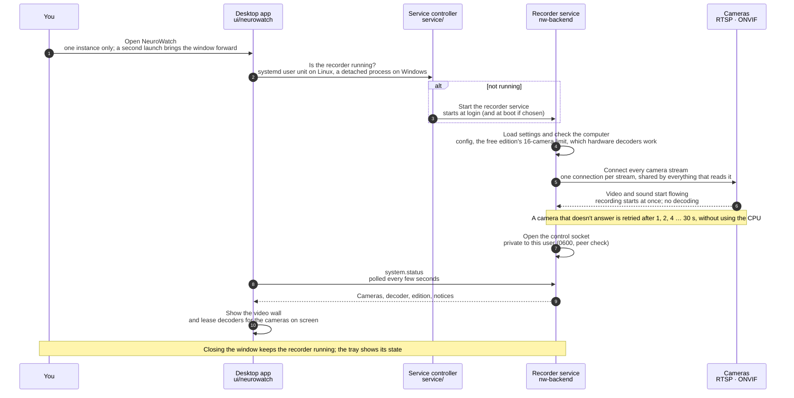

> Generated from the canonical page at [neurowatch.app/docs/architecture](https://neurowatch.app/docs/architecture). Do not edit this file by hand: change the page's source and regenerate it.

# Architecture

The recorder is one Rust binary built from modules around a shared application state. A plugin is a separate program built on an SDK. This page names the parts and shows how the service starts.

## Inside the recorder

*Recorder modules (crates/nw-backend/src)*

| Module | What it does |
|---|---|
| `streams/` | One hub per camera source: the connection, the GOP cache, per-subscriber queues, picture identities and the rates Diagnostics shows. |
| `pipeline/ingest` | Per-camera recording ingest and camera status. Never decodes. |
| `pipeline/supervisor` | Desktop view decoders, run only while a desktop window's lease names the camera. |
| `pipeline/hwaccel`, `decoder_health` | Ranking the hardware decoders, the VA-API version guard, and falling back to the CPU. |
| `shm/` | Shared-memory frame rings for the desktop app. |
| `recording/`, `storage_guard` | Segment index, retention, quotas, the archive tier and missing-drive protection. |
| `playback/`, `export/` | Desktop playback sessions, and MP4 export without re-encoding. |
| `events/`, `onvif_events/`, `alerts/`, `mqtt/` | The EventHub, the cameras' own events, notifications and Home Assistant. |
| `plugin_host/` | Plugin sessions, approval, media delivery, and the events and drawings that come back. |
| `ipc/` | The JSON-RPC server and its handlers; optional local accounts gate it. |
| `cloud/` | The optional link to NeuroWatch Cloud: signed check-ins, browser live view and playback, remote settings. |

Shared crates sit beside it: `nw-core` holds plain types (camera configuration, events, JSON-RPC messages) with no logic, and `nw-analytics-protocol` defines the plugin protocol's frames and messages.

### Threads and tasks

The IPC server runs one Tokio task per connection. Media work runs on GStreamer's own streaming threads, and each camera hub has a thread for its connection. SQLite writes for events go to a writer thread of their own. Work that can block, such as reading the playback index or tearing down a pipeline, runs on a blocking pool without holding the application-state lock.

> **Why.** A camera, a disk or a plugin can stall at any moment. Keeping each on its own thread or queue, and never holding a shared lock while waiting, means one stall cannot freeze the control socket or the other cameras.

## Inside a plugin

A plugin is a daemon the recorder connects to, on the same computer or another one. The SDK (`nw-analytics-sdk` in Rust; a Python SDK with a Rust transport helper) owns the transport, the signed identity and the framing. The plugin owns decoding and analysis.

- **Server.** Accepts sessions from recorders and presents a signed manifest: the event kinds it reports, its settings form (a JSON Schema the desktop and the portal both draw), its drawing layers and the permissions it needs.
- **One worker per camera binding.** Each has its own bounded inbox, decoder choice, rate limit and analysis state, so a busy camera does not hold up another.
- **Status.** Every 2 seconds each worker reports its rate, its decoder and any problem, in words the apps show as they are.

The protocol and the plugins' own decoding are in [Analytics plugins](plugins.md).

## Start-up

Opening NeuroWatch starts the service only if it is not already running. The service loads its settings, applies the free edition's 16-camera limit, finds out which hardware decoders work, connects every camera stream and opens the control socket. Recording starts as soon as video arrives, without decoding anything.

**Starting NeuroWatch.** The recorder runs as a background service. Opening the app only starts it if needed; closing the window leaves recording running.

> **Note.** If the control socket cannot be served, the service shuts down and exits with an error instead of running where nothing can reach it. The service manager allows only one service per socket.

## Supervision and restarts

`nw-backend --supervise` is a small parent process with no GStreamer in it. It runs the recorder as its child and starts it again when it stops unexpectedly: after 2, 5, 10 and then 30 seconds, with the delay reset once a run has lasted 10 minutes. A first run that fails within 10 seconds ends the supervisor too, so a broken installation is reported instead of retried for ever. Exit code 75 means "restart me now", which the recorder uses to restart in place.

Shutdown (a signal, or `system.shutdown`) stops cameras and finishes the open recording segments, with a 15-second watchdog in case something hangs. Under the supervisor, the next run is told how the previous one ended and records it with its start-up event.

> **Trade-off.** A restart reconnects every camera, so a crash still costs a few seconds of recording. The supervisor makes that a gap rather than an outage.

---

Previous: [Overview](overview.md) · Next: [Stream engine and buffers](stream-engine.md) · [All pages](README.md)
