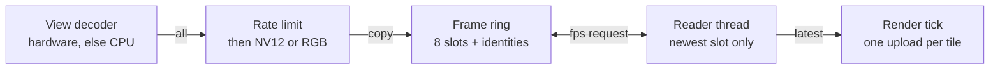

> Generated from the canonical page at [neurowatch.app/docs/desktop-rendering](https://neurowatch.app/docs/desktop-rendering). Do not edit this file by hand: change the page's source and regenerate it.

# Desktop rendering

The desktop app is Python and Qt, so the recorder does the heavy lifting and hands it finished pictures through shared memory. The app's job is to paint the newest picture of each visible camera once per tick, and never to fall behind.

**From decoder to screen.** Surplus pictures are dropped before colour conversion, at the rate the reader asked for. The recorder copies the rest into a ring in shared memory; the desktop app keeps only the newest per camera and paints each visible tile once per tick.

## Shared-memory frame rings

Each camera shown on the desktop has a ring at `/dev/shm/neurowatch_<camera>`, and each playback session one at `/dev/shm/neurowatch_pb_<session>`. On Windows they are named, pagefile-backed sections (`Local\neurowatch_<camera>`); the kernel reference-counts them, so a restarted pipeline reuses the same section.

A ring is a 64-byte header, an atomic write index and eight fixed-size slots. A slot holds width, height, byte length and the picture. The writer maps the GStreamer video frame and packs its rows and planes, with their real strides, straight into the slot, without an intermediate buffer.

> **Trade-off: Copies that remain.** This is not free. The decoded picture is copied into the ring, the reader copies the bytes out before handing them to Qt, and a hardware decoder's output is copied out of GPU memory first. What the ring avoids is serialising pictures over JSON-RPC and converting colour in Python.

## NV12 on the GPU, or RGB

Decoders produce YUV pictures, usually NV12; screens want RGB. When the wall has a real hardware OpenGL context, its reader writes `YUV1` (`0x31565559`) into header bytes 8–11. The recorder sees that and switches its output to NV12 on the running pipeline, without restarting it. The wall uploads the Y and UV planes as two textures and a shader converts them, applying the right matrix, range and chroma position for each picture along with the tile's zoom and pan.

An NV12 slot sets the high bit of its length. The payload starts with a four-byte colour descriptor (BT.601, BT.709 or BT.2020, full or limited range, chroma siting), then the Y plane, then the interleaved UV plane. Older readers skip slots marked this way.

> **Why.** Converting colour is one of the most expensive steps of showing video, especially when decoding is already done in hardware. On the GPU it is a few lines of shader work per picture. If the GL context fails, the wall drops back to RGB without restarting readers or decoders; software GL, remote desktops and `NW_GPU_VIDEO=0` use RGB from the start.

## The identity trailer

After its eight slots a ring keeps a table of each slot's picture identity (sequence number and capture time), plus an optional 8-byte receipt timestamp per slot. The layout only grows at the end, so older readers keep working. The wall uses the identity to draw a plugin's boxes on the picture they were found in (see [Analytics plugins](plugins.md#drawings)).

## The reader asks for a rate

Each reader writes the frame rate it wants into header bytes 4–7, as a little-endian `u32` in thousandths of a frame per second; zero means no limit. The recorder drops the pictures nobody asked for before colour conversion and copying. Decoding and recording continue at the camera's own rate. Changing the request, for example when a page is hidden, takes effect on the next picture without restarting anything.

The decoder's health counters count pictures before this pacing, so deliberate skips never look like dropped frames or a stalled decoder. Each ring has exactly one reader.

> **Not done or not measured.** Desktop playback does not use the rate request yet, and it still converts to RGB on the CPU.

## Latest frame only

A `FrameReaderThread` per camera copies the newest slot and signals the Qt main thread. The handler stores it as that camera's latest picture, replacing any it had not painted yet, and does no image work. A render timer then uploads at most one picture per visible camera per tick. Its interval is `max(8, round(500 / target_fps))` ms, sampling at twice the reader's rate so the two never lock into step.

The first picture of a camera with nothing on screen yet is painted at once, so a tile is never left blank waiting for a tick.

> **Why.** A queue of pictures behind the screen is lag: the wall shows the past and falls further behind under load. Keeping only the newest means a busy wall drops pictures but always shows the present.

## Preview rates

*Default desktop preview rates (Settings → Live Preview Frame Rate)*

| What is on screen | Default | Range |
|---|---|---|
| One camera | 25 fps | 1–60 |
| Up to 16 visible cameras | 15 fps | 1–60 |
| More than 16 visible cameras | 4 fps | 1–60 |
| Cameras on hidden pages | 2 fps | 1–30 |

The rate follows the number of cameras actually on the page, not the grid's size. Readers of hidden pages stay open at the hidden rate, but their decoders stop; a page shown again paints each tile's cached picture, marked as refreshing if it is old, until its decoder delivers. These limits are the desktop preview only: they never change what is recorded.

## Substreams and solo view

In a grid every camera shows its substream when it has one; a camera shown alone uses its main stream. A stream change restarts only that camera's view decoder, so requests are sent only when the wanted stream really changes. Leaving solo view restores the grid first, then the page, so only the solo camera switches streams.

## Instant page changes

Page changes have no fade and walls use no `QGraphicsEffect`. An effect composites every tile on every frame, including reading back GL textures, and dims the wall towards black while it runs.

> **Not done or not measured.** The app's tests run offscreen with stubbed readers. They check the logic (coalescing, rates, cached pictures, page restoring), not frame rates on a physical display or GPU.

---

Previous: [Decoding and hardware acceleration](hardware-decoding.md) · Next: [Recording, playback and export](recording.md) · [All pages](README.md)
