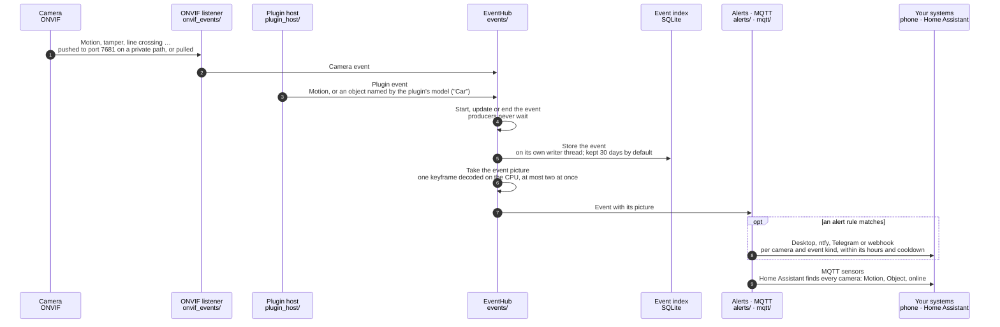

> Generated from the canonical page at [neurowatch.app/docs/events](https://neurowatch.app/docs/events). Do not edit this file by hand: change the page's source and regenerate it.

# Events and integrations

Camera events, plugin events and the recorder's own problems all go through one EventHub. Producers hand an event over and carry on; storage, pictures, alerts and MQTT follow from there.

## The EventHub

Producers call `start`, `update`, `end` or `instant`. The hub numbers events, keeps the last 1024 notices in memory for clients waiting with `events.wait`, broadcasts them to consumers inside the recorder (one that lags loses its oldest), and hands database writes to a writer thread of its own. A read waits for pending writes first, so it never misses one.

Every event has a start and, once over, an end. Open events are touched every minute; if the recorder stops, the next start closes them at the time they were last seen.

> **Why.** Events come from places that must not stall: ONVIF listeners, plugin sessions, health checks. If a slow disk or a busy database could make them wait, a database problem would turn into missed events and stalled cameras.

## Event kinds

- **From cameras (ONVIF):** motion, intrusion, line crossing, tampering, digital inputs, and other camera topics as generic camera events.
- **From plugins:** motion, or an object named by the plugin's model, such as "Person" or "Car". Each kind a plugin declares is its own event kind.
- **From the recorder:** camera offline, recording failing, disk low, recording storage missing, plugin offline, recorder started.
- **From people:** bookmarks, which can keep the footage they cover from being cleaned up.

## Camera events over ONVIF

Push comes first. The recorder listens on one port (7681 by default; 0 turns it off). Each subscription gets its own path with a 128-bit random token, accepted only from that camera's address, POST only, at most 256 KB and 5 seconds per request and 64 queued. A camera must deliver its first notification within 8 seconds of subscribing; otherwise the recorder cancels and pulls instead, for the life of that subscription.

Pulling uses ONVIF pull points: the camera holds each request up to 10 seconds and returns up to 64 messages; subscriptions are renewed every 60 seconds. Failures back off from 5 seconds to 2 minutes. Every address a camera returns is pinned to the camera's own host.

> **Why.** The event port is the only one the recorder opens to the local network, so it accepts as little as possible: live random paths, one camera's address each, small bodies and short requests. Pushing saves polling every camera; pulling covers cameras that cannot reach the recorder.

## Plugin events

A plugin may report only the kinds it declared. The recorder checks coordinates, confidence, rate, how many events it has open and that the picture it names is one it was sent. When a plugin's session ends, its open events end too.

## Event pictures

An event's picture is one keyframe decoded on the CPU: the recording's cached latest keyframe (a reference, from a 32 MiB cache), or one keyframe from a stream of the camera that is already open, or as a last resort a short connection of its own. Two workers at most make pictures, each a 640×360 JPEG of at most 128 KiB, within 5 seconds. Nothing keeps decoding afterwards, and producers never wait for a picture.

## Storage and retention

Events are stored in the recorder's SQLite index and kept 30 days by default (0 keeps them, at most 3650). Finished events past that age are deleted every 10 minutes with their pictures; kept bookmarks are not.

**Events, alerts and Home Assistant.** Camera events and plugin events go through one EventHub, which never waits on the database. Everything else subscribes to it.

## Alerts

Rules choose event kinds, cameras, weekly hours and a cooldown. Channels are the desktop, ntfy, Telegram and webhooks; external ones work without the cloud and can include the event picture, waiting up to 8 seconds for it. Each channel sends at most 20 alerts a minute, through one bounded delivery queue, and the last 100 deliveries are kept for checking.

> **Not done or not measured.** Email alerts are not implemented. Desktop notifications need the desktop app running; the other channels are sent by the recorder, headless included.

## MQTT and Home Assistant

With a broker configured, each camera appears in Home Assistant by discovery, with sensors such as Motion, Person and Object, Online, and a picture of the last event; the recorder appears too, with a Problem sensor. Other MQTT systems can read the same topics: `neurowatch/<camera>/person` and the others are `ON` or `OFF`, `neurowatch/events` carries every event as JSON, and `neurowatch/status` says whether the recorder is online. Recorders sharing a broker each get their own topic prefix.

---

Previous: [Analytics plugins](plugins.md) · Next: [Engineering in Rust](rust.md) · [All pages](README.md)
