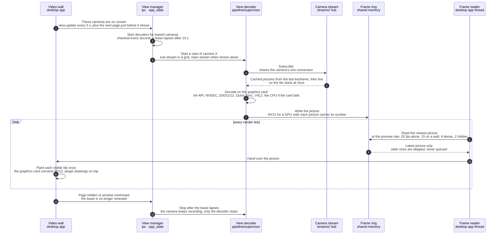
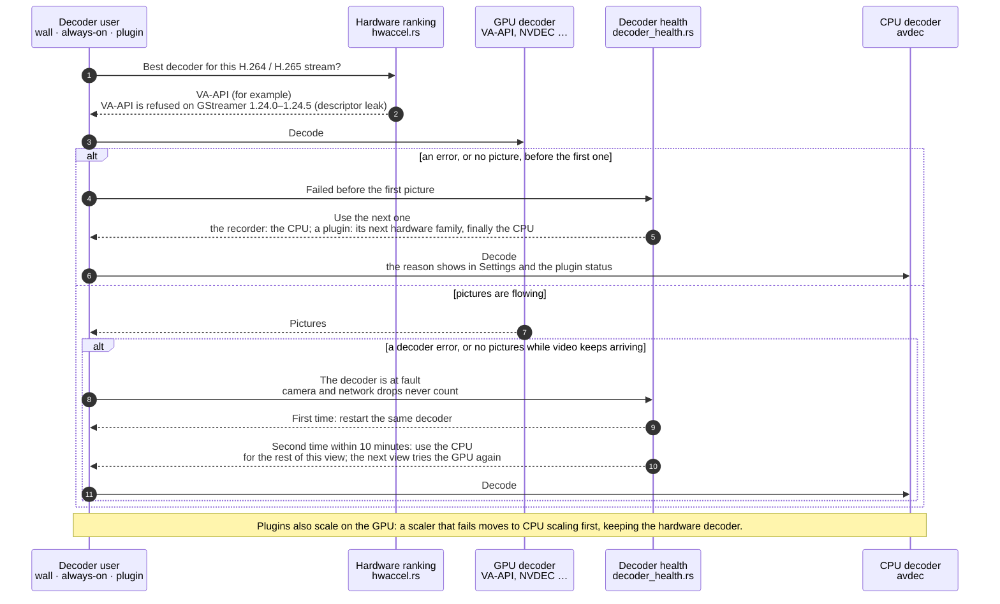

> Generated from the canonical page at [neurowatch.app/docs/hardware-decoding](https://neurowatch.app/docs/hardware-decoding). Do not edit this file by hand: change the page's source and regenerate it.

# Decoding and hardware acceleration

Decoding is the costliest thing a recorder does with video. NeuroWatch decodes as little as it can, on the graphics card when one works, and proves the card works before trusting it. When a hardware decoder fails, the camera moves to the CPU and keeps going.

## When video is decoded

Video is decoded in these cases only:

- **Desktop views:** the cameras a desktop window shows, while it shows them.
- **Always-on decoding:** a camera stream you choose to decode all the time, for plugins.
- **Desktop playback:** the cameras on the playback screen.
- **Event pictures, snapshots and portal thumbnails:** one keyframe per request, on the CPU, at most two at once. Nothing stays running.
- **H.265 for a browser that can't play it,** when the camera has no H.264 stream to show instead (see [Browser viewing](browser-viewing.md#transcoding)).

Recording, browser viewing, browser playback and clip export never decode video. Browser sound is decoded, but only the sound. Tests list the GStreamer elements running on those paths to check that no video decoder or encoder appears.

## View leases

The video wall tells the recorder which cameras it shows (`view.update`) as soon as that changes and again every 3 seconds. A lease lapses after 10 seconds. Once a second the recorder starts decoders for leased cameras and stops those whose lease lapsed. A hidden page, a minimised window or a crashed app therefore leaves no decoders behind.

Auto-scroll adds the next page to the lease 3 seconds before it shows, so that page opens on live pictures. Each extra window on another monitor leases its own cameras.

> **Trade-off.** A camera shown again after being hidden needs its decoder to start and reach a keyframe. Meanwhile its tile shows the last picture, marked as refreshing; the GOP cache keeps that wait short.

**Watching cameras on the video wall.** A camera is decoded only while it is on screen. The app leases decoders; the recorder decodes into shared memory; the app paints the newest picture.

## Decoder families

*Hardware decoder families*

| Family | Where | GStreamer elements (H.264 shown) |
|---|---|---|
| VA-API | Linux, Intel and AMD graphics | `vah264dec` (the modern `va` plugin), legacy `vaapih264dec` |
| NVIDIA NVDEC | Linux and Windows, NVIDIA graphics | `nvh264dec` |
| Direct3D 11 | Windows | `d3d11h264dec` |
| Direct3D 12 | Windows | `d3d12h264dec` |
| Intel Quick Sync | Windows and Linux, Intel graphics | `qsvh264dec`, legacy `msdkh264dec` |
| V4L2 | Linux on ARM boards such as the Raspberry Pi | `v4l2h264dec` (stateful), `v4l2slh264dec` (stateless) |
| Software | Everywhere | `avdec_h264`, `avdec_h265` (FFmpeg) |

Settings → Video Wall chooses a family or Automatic. Automatic tries VA-API, then NVDEC, then Direct3D 11, then V4L2, and uses the first that works. A change of family restarts the service, because the choice applies to the whole process.

## Choosing by rank, not by pipeline string

Decoders are built by `decodebin`, which picks the highest-ranked element for a format. At start-up the recorder raises the chosen family's decoders above every other in GStreamer's registry. The choice then holds wherever `decodebin` is used: live view, playback, thumbnails and pictures shared with plugins, without each pipeline naming its decoder.

It loads every alternative first and gives each a distinct rank, never lowering ranks that were already higher. Within a family the modern plugin comes first: `va` before `vaapi`, `qsv` before `msdk`.

> **Why distinct ranks.** With equal ranks, `decodebin` breaks the tie by element name. On an Intel UHD 620 that chose a broken legacy path and the tiles stayed blank. On a computer with Intel and NVIDIA graphics, `vah264dec` and `nvh264dec` both registered one above primary, and video decoded on NVIDIA while the app reported VA-API.

## The VA-API version guard

GStreamer's `va` plugin versions 1.24.0 to 1.24.5 leak DMA-BUF file descriptors while discovering formats. The recorder checks that plugin's own version before it creates any pipeline, and removes the plugin from its registry when the version is affected or cannot be read. Desktop live view is then blocked with the reason on screen, rather than silently moved to the CPU. Recording and browser viewing carry on, because they never decode.

> **Why.** A descriptor leak does not fail at once: the process runs out of descriptors hours or days later and every pipeline starts failing. Refusing the known-bad versions up front turns a slow, confusing failure into a clear message. The release packages bundle a GStreamer without the leak.

## GPU access at boot, and missing drivers

A service started at boot, before the desktop session has given the user access to the GPU's render node (or, on ARM, the V4L2 decoder node), would run without hardware decoding for its whole life: GStreamer registers no hardware decoders it cannot open. The recorder notices, checks every 5 seconds, and once the device opens it restarts itself in place, keeping its process id. The Linux packages also add regular accounts to the `render` and `video` groups.

A graphics card whose driver is missing (Intel's or Mesa's VA driver, or NVIDIA's decoding library) is reported by name, with the package to install, instead of looking like a computer with no graphics card.

## Decoder health and CPU fallback

**Before the first picture.** A hardware decoder has to prove itself. An error from it before its first picture moves that view to the CPU straight away; in a plugin, to the next hardware family and finally the CPU. The reason shows in Settings and in the plugin's status.

**While running.** A failure counts against the decoder only when the decoder caused it: an error raised by the hardware decoder element or something inside it, or a stall, meaning no picture for 10 seconds while the stream is up and units arrived in the last 2 seconds. The first such failure restarts the same decoder. A second within 10 minutes moves that view to the CPU for the rest of its life; the next view tries the hardware again.

> **Why only the decoder's own failures count.** Cameras drop out and networks hiccup. If those counted, every flaky camera would push its views onto the CPU for no reason. A dropped connection, the end of a stream or a problem feeding the decoder never counts against it.

**Choosing a decoder and falling back.** The same rules apply to the wall, the always-on decoder and every plugin: use the graphics card, prove it works, fall back to the CPU without losing the camera.

> **Not done or not measured.** The running fallback covers desktop views and always-on decoders. It does not yet cover native X11 overlay views, desktop playback, sources not on a shared connection, or thumbnails. It has not been run on a Raspberry Pi in development; it is checked by a test that forces CPU decoding on a VA-API machine. A format error further down the pipeline can name the decoder as its source and be counted against it; the two-in-ten-minutes rule bounds what that costs.

## Decode once, share the pictures

You can set a camera stream to be decoded all the time (Edit Camera → Decoding), for plugins that want pictures. That always-on decoder is `appsrc ! decodebin ! videoconvert ! video/x-raw,format=NV12 ! appsink` at the stream's own size, in system memory. Plugins on the same computer take its pictures, and a wall showing that stream borrows them too and decodes nothing itself.

A borrowing wall pushes the newest borrowed picture into its own display tail. If no picture arrives for 8 seconds while the stream is up, it gives up borrowing and decodes for itself for the rest of its life. Without an always-on decoder, a local plugin can reuse the pictures a wall already decodes. When both exist, the always-on pictures win, so plugins keep one source as walls open and close.

> **Trade-off.** Shared pictures live in system memory. A hardware decoder's GPU buffers are never held outside their pool, because holding them could starve the decoder; each shared picture is therefore copied down from the GPU once.

## Active decoder versus GPU counters

Two facts are shown separately. The active decoder is the family the recorder chose, or why local live view is blocked; it is what the status bar and Diagnostics name. GPU counters are optional: NVIDIA's tools report load, VA-API reports none. A missing counter does not mean hardware decoding is off, and it is shown as unavailable, never as 0%.

---

Previous: [Stream engine and buffers](stream-engine.md) · Next: [Desktop rendering](desktop-rendering.md) · [All pages](README.md)
