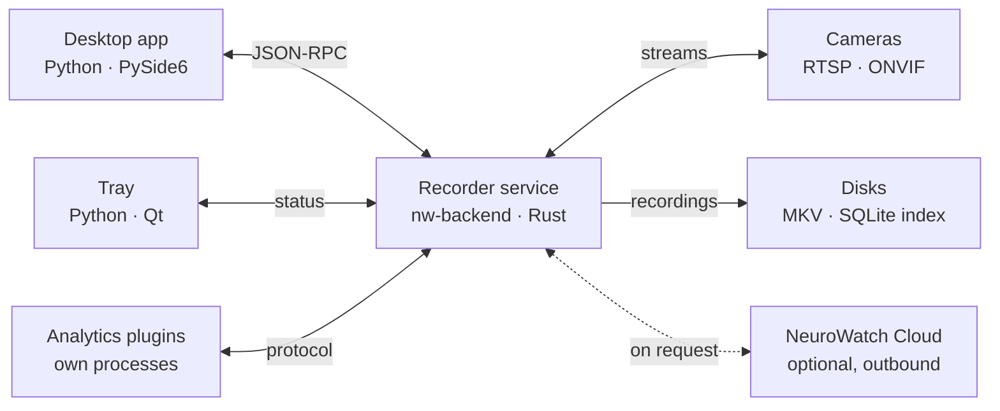

> Generated from the canonical page at [neurowatch.app/docs](https://neurowatch.app/docs). Do not edit this file by hand: change the page's source and regenerate it.

# Overview

NeuroWatch is a video recorder for IP cameras. These pages explain how it is built: which process does what, how video moves through it, and why each design choice was made. They are written for engineers and describe the code as it is today.

## What runs where

NeuroWatch is several programs, each in its own operating-system process. Only one of them, the recorder service, has to keep running for cameras to be recorded.

*The processes*

| Process | Built with | Job |
|---|---|---|
| Recorder service (`nw-backend`) | Rust, Tokio, GStreamer | Connects to cameras, records, plays back, decodes for the desktop, serves the desktop app and plugins, and links to NeuroWatch Cloud when you ask it to. |
| Desktop app (`neurowatch-ui`) | Python, PySide6 (Qt 6) | The video wall, playback, settings and Diagnostics. It starts the service if it is not running; closing it leaves recording running. |
| Tray | Python, Qt | Shows the service's state and starts, stops or restarts it. |
| Analytics plugins | Any language; SDKs for Rust and Python | Analyse video and send back events, drawings and status. NeuroWatch Motion and NeuroWatch Detect are the free ones. |

**What runs where.** Each box on the left is its own process, talking to the recorder service over JSON-RPC, shared memory or the plugin protocol. Only the recorder service must keep running; the others can stop, crash or restart without touching recording.

> **Why.** Recording must not stop because something else failed. A crash in the window, a plugin or a detection model costs that process only. The service itself runs under a small supervisor that starts it again if it ever exits unexpectedly.

## Process model and IPC

The recorder is a per-user background service: a systemd user unit on Linux, a detached process under its own supervisor on Windows. It starts at login by default, can start at boot on Linux, and keeps recording with no window open. On a computer without a screen it runs headless.

The desktop app and the tray talk to it with newline-delimited JSON-RPC 2.0. On Linux that is a Unix socket at `$XDG_RUNTIME_DIR/neurowatch/control.sock`, created `0600` in a private `0700` folder, and the service checks the caller's user id. On Windows it is loopback TCP, which other local accounts can also reach; a random per-user token, in a file only that user can read, is required for the cloud methods. That is why the supported setup is one trusted user session per recorder. Each call opens a connection, sends one request and reads one reply.

There is no push channel. The app polls status every few seconds and waits for events with a long poll (`events.wait`, up to 25 s). Video never travels over JSON-RPC: decoded pictures go through shared-memory rings, described in [Desktop rendering](desktop-rendering.md).

> **Trade-off.** One request per connection is simple and survives either side restarting, but it is not instant: a change shows on the next poll. The rule is that slow calls run on worker threads, never on the window's thread; a few older calls still run there and are being moved as that code is touched.

## Design principles

### Decode only what is watched

Decoding is the expensive part of a video recorder. Recording, browser viewing and clip export work on the camera's compressed video. The desktop decodes only the cameras on screen, and a hidden or minimised wall decodes nothing. See [Decoding and hardware acceleration](hardware-decoding.md).

### One connection per camera stream

Each camera stream is opened once. Recording, the wall, browsers, plugins and snapshots subscribe to it and receive references to the same compressed units, not copies. See [Stream engine and buffers](stream-engine.md).

### Never block a streaming thread

Code that runs on a GStreamer streaming thread wraps the data and hands it on. A full queue drops by its own rule instead of making the camera wait, and an event never waits for the database.

### Everything is bounded

Every queue has limits in bytes, units and time, and a rule for what it loses when full. A slow disk, browser or plugin loses its own data and nobody else's.

### Say what is happening

Diagnostics draws each camera stream as a tree: its codec and rate, its buffer, every reader, and a box wherever a picture is decoded. A decoder that falls back to the CPU says why. A counter the driver does not report is shown as unavailable, never as a made-up 0%.

## About these pages

> **Note: No benchmark figures.** These pages contain no benchmark figures on purpose: the load depends on your cameras, codecs, graphics hardware and how many cameras are on screen. Sizes, intervals and limits are design constants from the code. Diagnostics shows the real numbers for your own recorder.

The recorder is open source under Apache-2.0. The same pages are kept as Markdown in the recorder's repository on GitHub, under `docs/technical/`, generated from this site.

---

Next: [Architecture](architecture.md) · [All pages](README.md)
