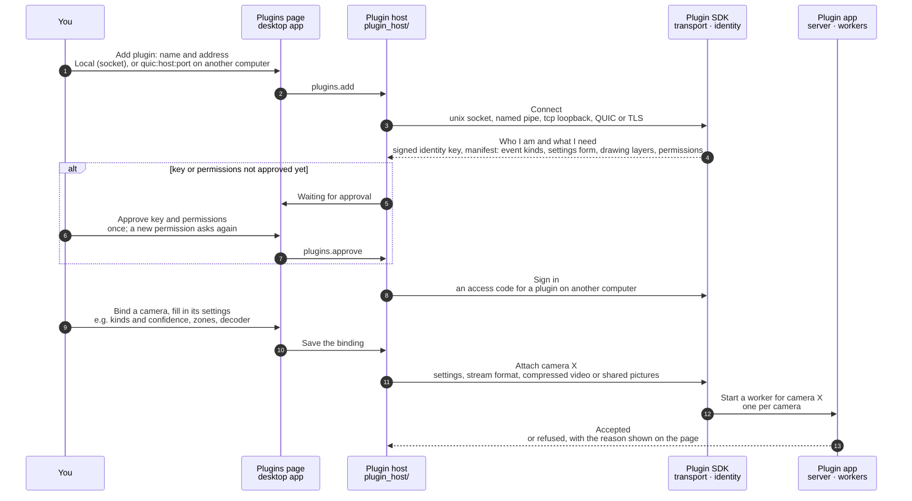
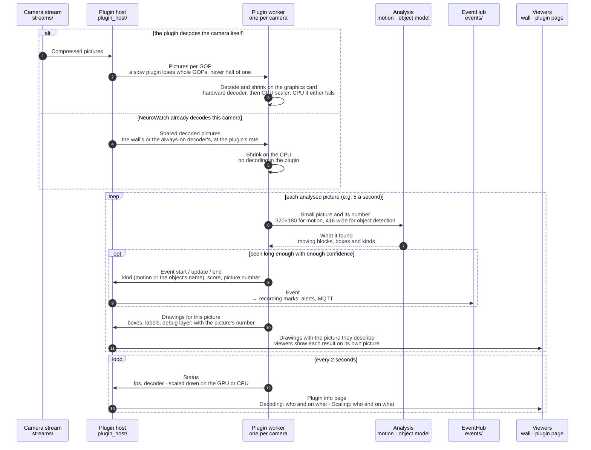

> Generated from the canonical page at [neurowatch.app/docs/plugins](https://neurowatch.app/docs/plugins). Do not edit this file by hand: change the page's source and regenerate it.

# Analytics plugins

Analytics run in separate programs, on the same computer as the recorder or another one. The recorder sends video; a plugin sends back events, drawings tied to the picture it analysed, and its status. Motion detection and object detection are plugins too.

<a id="why-separate"></a>
## Why separate processes

> **Why.** Recording must never fail because of analysis. A plugin that crashes, falls behind or is being updated costs its own events, and the recorder shows it as offline; cameras keep recording. A plugin can also run on another computer, to take the work off the recorder.

The recorder never starts a decoder, scaler or colour converter for a plugin. It forwards compressed video, or offers pictures it is already decoding for something else.

<a id="transports"></a>
## Transports

*Plugin addresses*

| Address | Use |
|---|---|
| `unix:/path/plugin.sock` | Same computer, Linux. Add Plugin → Local finds running plugins. |
| `pipe:\\.\pipe\name` | Same computer, Windows; local clients only. |
| `tcp:127.0.0.1:7690` | Loopback, for development. |
| `tls:host:7690` | TLS 1.3 over TCP, when UDP is blocked. |
| `quic:host:7690` | Encrypted delivery to another computer. |

Both encrypted transports use TLS 1.3 with the ALPN `nw-analytics/1`. On QUIC there is one reliable stream for control and a separate one-way stream for each group of pictures, so a plugin that falls behind can abandon whole old GOPs, never half of one. TLS over TCP carries the same framed byte stream as a local socket.

<a id="framing"></a>
## Framing and messages

```text
frame  = length (u32, little-endian) · kind · body
kind 1 = JSON-RPC message, at most 1 MiB
kind 2 = 40-byte media header + Annex-B payload, at most 16 MiB
```

A session starts with `hello`, then authorisation and approval, then `attach` for each camera. `stream_format` comes before any media. Settings, validation, detach and liveness travel on the control channel. A refused attachment is retried after the delay the plugin gives, or 30 seconds; a lost session reconnects after 2, 5, 10 and then 30 seconds.

<a id="identity-and-approval"></a>
## Identity and approval

Each plugin has a persistent Ed25519 key and a signed manifest: its event kinds, settings form, drawing layers and permissions (`video`, `events`, `overlays`, `decoded_frames`, `web_ui`). An administrator approves the key and the exact permissions before the recorder sends any video, camera binding or credential. A new key needs approval again, and so does a new permission.

Over QUIC and TLS the plugin's certificate uses the same key, and the manifest's signature covers both sides' challenges and the TLS session's exporter value, so a manifest cannot be replayed on another connection. A plugin on another computer also asks for an access code. Vendor credentials are write-only, kept private on the recorder, and tied to that server and its approved key.

**Adding a plugin and choosing cameras.** A plugin is a separate program. It introduces itself, you approve its key and permissions once, then you bind cameras with their own settings.



<a id="delivery"></a>
## Compressed units or shared pictures

**Compressed, by default.** The plugin receives the camera's H.264 or H.265 as Annex-B units and decodes them itself. In `latest` mode it abandons out-of-date GOPs and resumes at a keyframe with a gap; in `reliable` mode it keeps order within a bounded delay and byte budget, then reports what was lost. Each session's outbox is bounded at 256 frames or 32 MiB, so a slow or hostile plugin cannot hold up the recorder.

**Shared pictures, when they already exist.** If a wall or an always-on decoder is already decoding the stream, a plugin on the same computer can have those pictures instead: RGB24, NV12 or just the Y plane, copied into a private, read-only ring at the rate it asks for (at most 30 per second). Rings are bounded at 32 MiB and 4096 pixels a side. A plugin may ask for a minimum size, to be given a larger stream of the same camera that is already decoded.

Before offering a ring, the recorder makes the plugin prove it runs on the same computer: it hands over a fresh secret in a read-only capability that only a local process can read back. If no picture arrives for a second, the SDK goes back to the compressed GOP it keeps by reference (16 MiB or 1024 units).

> **Why.** Decoding the same stream twice, once for the wall and once for the plugin, is the waste this avoids. The locality proof makes sure memory is never offered to a peer on the network.

<a id="decoding-in-a-plugin"></a>
## Decoding inside a plugin

The free plugins follow the recorder's decoder rules: hardware first in a ranked order, a 10-second trial for the first picture, then two decoder-caused failures within 10 minutes to give a decoder up, ending on the CPU, with the reason in the plugin's status.

They limit their analysis rate with a timestamp check on the decoder's output, not with `videorate`, which lets every picture through when it joins a stream whose timestamps start high or whose caps carry no frame rate.

They scale down on the GPU before downloading the picture, when the stream is larger than the analysis size: `vapostproc` for VA-API, `cudaconvertscale` and `cudadownload` for NVDEC, `d3d11convert` or `d3d12convert` and a download for Direct3D. Quick Sync, the legacy plugins and V4L2 scale on the CPU. A GPU scaler that fails its trial is dropped and the same hardware decoder is rebuilt with CPU scaling; only after that does the decoder fallback move on.

> **Not done or not measured.** GPU scaling has not been run on real GPU scalers in development: the development machine's driver registers no `vapostproc`. The fallback to CPU scaling is what keeps an untested scaler from costing a camera.

**How a plugin analyses a camera.** The recorder sends the plugin video; the plugin sends back events, drawings tied to the picture it analysed, and its status.



<a id="drawings"></a>
## Drawings tied to pictures

A plugin sends drawings as data: boxes, polygons, lines and text in coordinates from 0 to 1 of the picture it analysed, with style names (`accent`, `warning`, `series1`…) rather than colours, and the identity of that picture. The recorder checks them (at most 256 items, 64 points each, eight lines of 64 characters of text, 25 updates a second per layer, a lifetime of 0.1 to 10 seconds).

Viewers draw each result on the picture it describes. The desktop keeps a short history per layer and shows the newest result that the picture on screen has reached; a browser maps RTP timestamps back to picture identities. Shapes are drawn as vectors at the screen's resolution, so text stays sharp at any tile size.

> **Why.** The usual alternative is an annotated video: the analyser draws into its pictures and encodes them again, and the viewer decodes a second stream. Sending data instead costs no encoder or decoder, keeps boxes on the right picture whatever the analysis delay, and leaves the recording untouched.

<a id="status"></a>
## Status in plain words

Every 2 seconds a worker reports its rate and its decoder as text, such as `VA-API · scaled down on the GPU`, or `NeuroWatch's pictures (no decoding here) · scaled down on the CPU` when it uses shared pictures. While it shares pictures, the recorder adds who decodes them (an always-on decoder or a video wall) and on what. The desktop and the portal show this as two lines: Decoding, and Scaling to analysis size.

<a id="free-plugins"></a>
## The free plugins

- **NeuroWatch Motion:** Finds movement by comparing small pictures (320×180), with watched and ignored areas, a minimum duration and a keyframes-only low-CPU mode. Source: [github.com/ttheekw/Neurowatch-Motion](https://github.com/ttheekw/Neurowatch-Motion).
- **NeuroWatch Detect:** A small built-in object detection model on the CPU, on pictures 416 pixels wide. It knows 80 everyday kinds; each kind you tick is its own event, named after it. It reports what it sees: it does not count and does not recognise faces. Source: [github.com/ttheekw/Neurowatch-Detector](https://github.com/ttheekw/Neurowatch-Detector).

---

Previous: [Browser viewing](browser-viewing.md) · Next: [Events and integrations](events.md) · [All pages](README.md)
