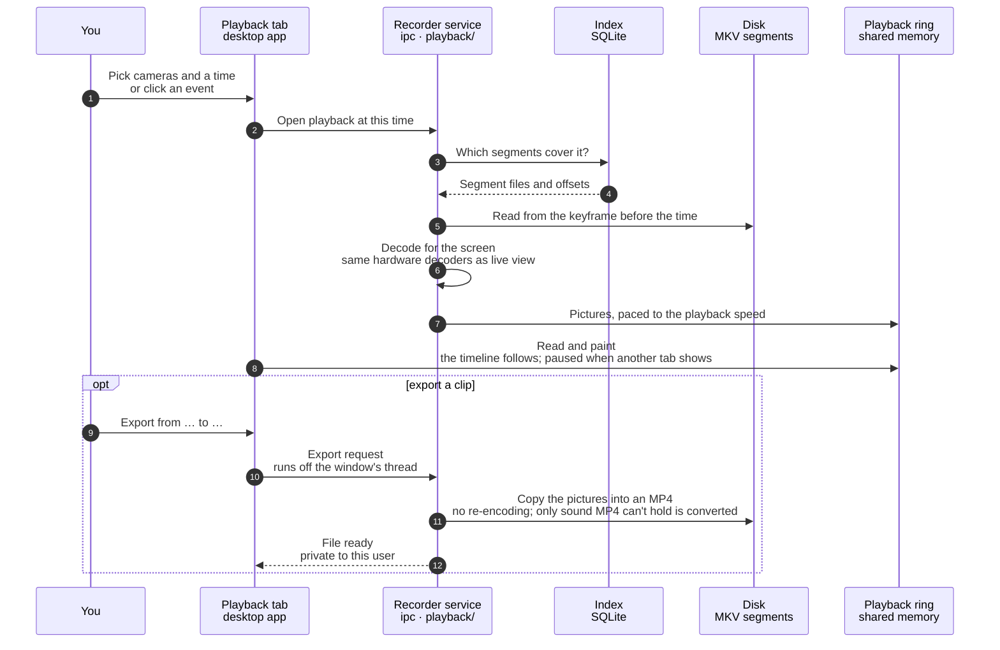

> Generated from the canonical page at [neurowatch.app/docs/recording](https://neurowatch.app/docs/recording). Do not edit this file by hand: change the page's source and regenerate it.

# Recording, playback and export

Recording keeps exactly what the camera sent. A local SQLite index finds it again, retention and the storage guard keep the disks in check, playback decodes only what the screen shows, and export copies compressed video into an MP4.

## Segmented Matroska, as the camera sent it

The recording subscriber starts each run at a keyframe and pushes units into `splitmuxsink` with `matroskamux`, which cuts the run into segment files and finishes each one in the background. Timestamps are rebased to the run, with presentation and decoding times kept apart for B-frames. Nothing is transcoded: H.264 and H.265 stay as they are, MJPEG over HTTP is stored as JPEG, and a V4L2 device, which gives no compressed video, cannot be recorded.

Files are named `{camera}_{run start ms}_{sequence}_{fragment}.mkv`. The run's start is the arrival time of its first keyframe less that picture's presentation lead, so the index can turn every picture's timestamp into wall-clock time exactly.

Sound is recorded when the camera describes a track Matroska can keep (AAC, G.711, Opus or PCM) and its first sound arrives within 1.5 seconds of the picture. A lost connection or a change of format ends the run, its last segment is finished, and the next run starts with the new stream.

> **Why.** Keeping the camera's own bitstream means recordings keep the camera's quality, the recorder needs no encoder, and recording a camera costs a parse and a disk write rather than a decode. Short segments bound what one damaged file can lose and let retention delete whole files.

## The SQLite index

The index (`neurowatch.db`, in WAL mode) holds segments (camera, stream, times, codec and which tier they are on) and events. A scanner runs every 30 seconds: each camera's whole folder once, then only the last two days. It indexes only files that start with a Matroska header, and it reads a segment's start from its name, so a short fragment is never drawn as a full-length one.

## Retention and quotas

After each index pass, retention deletes the oldest indexed segments, file and row: for each camera beyond its own quota, and across cameras while a recording drive is fuller than its limit (90% by default). It never deletes a file written in the last 60 seconds, never a file it did not index, and never footage a kept bookmark covers (plus 30 seconds either side).

## The storage guard

Every recording location gets a marker file, `.neurowatch-storage`, holding a random id the configuration remembers. A location counts as missing when the marker is gone, holds another id (a different drive is mounted there), or sits under an `/etc/fstab` mount point that is not mounted. A camera whose location is missing keeps streaming but does not record, and one storage-missing event names the folder. Recording resumes by itself when the drive is back.

The checks run on their own thread with a 3-second limit, one at a time per location, and their results are cached; the once-a-second recording scheduler reads the cache and touches no file system. Every location is checked again every 30 seconds.

> **Why.** An unmounted network share or USB drive leaves an empty folder on the computer's own disk. Recording into it would fill the system disk without anyone noticing. A hung NFS mount must not hang the recorder either, hence the time limit.

## The archive tier

The archive moves recordings older than a set number of days (7 by default) from the recording drive to another folder, typically a NAS. Each segment is copied to a `.part` file at the speed you allow, flushed, read back and compared by size and SHA-256, renamed, and only then is the original deleted and its index row pointed at the copy, under the index lock. A pass runs every 5 minutes, within the hours you allow. Playback and export read either tier through the index.

> **Trade-off.** Recording to a local disk and archiving to the NAS means a network problem only delays the archive. Recording straight to the NAS would stall the recorder's writes whenever the network does.

## Playback

Each desktop playback session has its own ring. It joins a run's finished files into one stream (`splitmuxsrc`) and builds the next part, paused and hidden, 5 seconds before the current one ends, so a file boundary costs about one frame interval. It seeks from the keyframe before the time asked for, decodes with the same hardware ranking as live view, paces pictures to the playback speed, and pauses when another tab is shown.

**Playback and exporting a clip.** Playback decodes only what the desktop shows. Exporting copies the recorded video into an MP4 without re-encoding it.

> **Not done or not measured.** Desktop playback converts pictures to RGB on the CPU; the NV12 path the live wall uses is not done for playback yet. Recording gaps stay gaps: playback shows them as they are.

## Export to MP4 without re-encoding

A clip is cut from the recordings with `matroskademux → parsebin → h264parse/h265parse → mp4mux (faststart) → filesink`. Nothing decodes the video. The clip starts at the keyframe at or before the time asked for, so it may start a moment early, and ends with the last picture before the end. A gap of more than 2 seconds between files is left out, a change of codec or picture size ends the clip there, and MJPEG recordings cannot be exported.

Matroska keeps presentation times only, but MP4 needs decoding times when pictures are reordered (B-frames). The exporter reads the first 16 pictures ahead to measure how far they reorder and derives each picture's decoding time from that.

Sound that MP4 can hold (AAC, Opus) is copied. G.711 and PCM, which MP4 players do not read, are decoded and encoded to AAC with the cheapest encoder installed. A job writes `<file>.part` and renames it when complete. At most two exports run at once, each up to 24 hours long.

> **Why.** Copying keeps the camera's quality and avoids decoding and encoding the whole clip again, which is why an export finishes quickly.

---

Previous: [Desktop rendering](desktop-rendering.md) · Next: [Browser viewing](browser-viewing.md) · [All pages](README.md)
