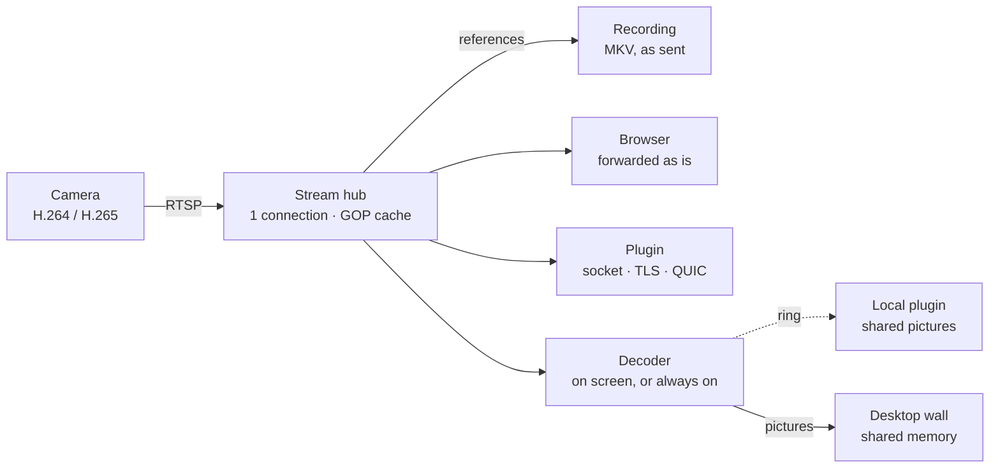
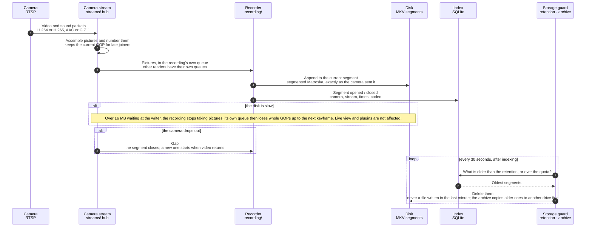

> Generated from the canonical page at [neurowatch.app/docs/stream-engine](https://neurowatch.app/docs/stream-engine). Do not edit this file by hand: change the page's source and regenerate it.

# Stream engine and buffers

Every camera stream is opened once. What arrives is parsed into compressed access units, numbered, and handed by reference to everything that needs it. Each reader has its own bounded queue, so a slow one never holds up the camera or anyone else.

**The path of a camera stream.** One connection, one buffer, many readers, each with its own queue. Only the decoder decodes video, and it runs only for a wall on screen or a stream you choose to decode all the time.

## One hub per camera stream

`StreamHubs` keeps one hub per resolved source: camera, address, credentials and transport. A Main and a Sub that point at the same address share one hub. The hub opens its connection when its first subscriber arrives.

A hub's thread runs a GStreamer pipeline: `rtspsrc` → `rtph264depay ! h264parse` or `rtph265depay ! h265parse` (other video through `parsebin`) → `appsink`. The appsink's caps are the ones Matroska stores, so units come out already in the form the recording writes. A sound track Matroska can keep (AAC, G.711, Opus, PCM) gets an appsink of its own. RTMP, MJPEG over HTTP and files go through the same hub, video only.

The appsink callback wraps each sample (buffer, caps, arrival time) as a shared unit and pushes it into every subscriber's queue. Cloning a GStreamer buffer increments a reference count; the bytes are not copied.

> **Why.** A camera then sees one client however many things use it. Many cameras allow only a few connections, and every extra connection costs the camera, the network and the recorder another parse.

## Picture identities

Before fan-out each unit gets a full-width sequence number and a UTC capture time (`time_us`), plus the time the recorder received it (`observed_us`). Everything downstream refers to pictures by this identity: a plugin names the picture it analysed, the desktop ring carries it in a trailer, and browser viewing maps RTP timestamps back to it.

> **Why.** A plugin's result arrives later than the picture it describes. With an identity on both, a box can be drawn on exactly the picture it was found in, however long the analysis took. Plugins can only refer to pictures they actually received; the recorder checks.

## The GOP cache

The hub keeps the units since the last keyframe, up to 16 MB or 1024 units. A subscriber that joins a running connection gets that cached group of pictures first, so its decoder starts at once instead of waiting for the camera's next keyframe. The same cache answers a browser's keyframe request (see [Browser viewing](browser-viewing.md)).

> **Trade-off.** The cache costs memory for every open stream; the cap bounds it. A camera with a long keyframe interval makes every joiner decode through more pictures before it reaches the live one.

A subscriber's queue limits apply to that cached group too, except for browser live view, which always gets all of it: its limits are for a viewer falling behind, and a start cut short would leave the viewer waiting for the camera's next keyframe.

## Per-subscriber queues

Each subscriber has its own bounded queue, limited by bytes, unit count and time span, and its own rule for what to lose when the queue is full. The hub never waits for a subscriber: pushing into a full queue applies that rule and returns.

*Queue limits and loss rules*

| Reader | Limit | When it falls behind |
|---|---|---|
| Recording | 64 MB · 4096 units · 10 s | Skip to the next keyframe; the gap is marked |
| Desktop view | 16 MB · 64 units · 1 s | Skip to the next keyframe |
| Browser live view | 16 MB · 256 units · 2 s, counted after the cached GOP it starts with | Skip to the next keyframe |
| Plugin, `latest` mode | as the desktop view | Skip to the next keyframe; the plugin is told of the gap |
| Plugin, `reliable` mode | up to 10 s · 1200 units · 32 MB, as the plugin asks | Keep order; past the budget, skip and report the loss |
| Live sound | 1 MB · 1 s | Drop the oldest |
| Snapshot | 1 unit | Takes one keyframe and leaves |

> **Why skip to a keyframe.** Dropping single video units leaves the decoder with references to pictures it never got, and it shows corrupted video until the next keyframe. Skipping to the next keyframe loses more, but everything shown stays decodable. Sound has no such dependency, and late sound is worthless, so sound drops its oldest instead.

## Linger and reconnects

A hub closes when its last subscriber has left and that subscriber's linger has passed: 10 seconds for live readers, so paging through the wall or a browser joining again reuses the open connection; zero for recording.

A lost connection is retried with backoff from 1 second, doubling to 30 seconds, with jitter. Every subscriber gets a discontinuity and stays attached through the reconnect. Recording ends its run cleanly and starts the next at a keyframe. A change of format (another resolution or codec) reaches decoders at the exact unit where it happened, and they rebuild from there.

## Recording is isolated from slow disks

The recording subscriber feeds `appsrc ! queue ! splitmuxsink`. When more than 16 MB is waiting at the writer (the disk is behind), it stops taking units and leaves them in its own subscription, whose limit decides what is lost. Nothing upstream waits, so live view and plugins carry on whatever the disk does.

**Recording.** The camera's compressed video goes to disk as it arrives. Nothing is decoded, and a slow disk only slows the recording's own queue.

A test checks that a recording made through the hub is byte-for-byte the camera's bitstream, the same as one made on a dedicated connection. Setting `NW_STREAM_HUB=0` still records on a dedicated connection, for comparison.

## Measuring it

Each hub reports its state (connecting, streaming, retrying, idle while lingering), subscriptions by role, the compressed bitrate and frame rate measured where units fan out, how full the GOP cache is, and each subscriber's drops. Reading these never opens a connection or drains a queue. Diagnostics, on the desktop and in the portal, draws them as a tree per stream.

> **Not done or not measured.** Rates are payload bits per second, without network protocol overhead, and are unknown for the first second of a connection. Counts are subscriptions, not people: one browser publication can serve several viewers.

---

Previous: [Architecture](architecture.md) · Next: [Decoding and hardware acceleration](hardware-decoding.md) · [All pages](README.md)
